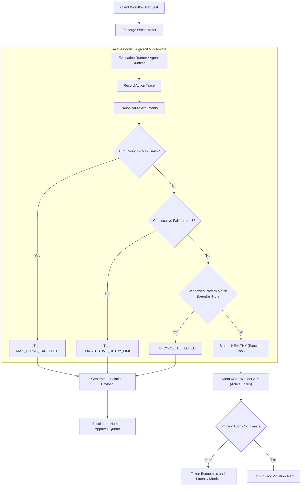

# Integration Flow Diagram

Architecture of the Active Focus loop guardrail and benchmark evaluation engine within Toolforge.

## Component Linkages

- Input requests arrive from [src/index.mjs](file:///C:/dev/.worktrees/eval-muse-wonder/toolforge/skills/evaluate-muse-wonder-active-focus/src/index.mjs).
- State evaluation and pattern detection occur in [src/loop-guard.mjs](file:///C:/dev/.worktrees/eval-muse-wonder/toolforge/skills/evaluate-muse-wonder-active-focus/src/loop-guard.mjs).
- Scenario simulation and economics profiling occur in [src/evaluation-engine.mjs](file:///C:/dev/.worktrees/eval-muse-wonder/toolforge/skills/evaluate-muse-wonder-active-focus/src/evaluation-engine.mjs).
